# Choco-Abema📺
## どんな環境からでも自由にAbemaを!
これはrenderやrailway環境から動くABEMAサイトです <br>
ちなみに広告も消してます笑 <br>
ぜひデプロイして、学パソ、学タブの利用の幅を広げていきましょう！！

## 目次
[概要](#概要)
[サイトアイコン](#サイトアイコン)
[スクリーンショット](#スクリーンショット)
[Q&A](#Q&A)
[デプロイについて](#デプロイ)
[その他](#その他)

## 概要
Choco-Abemaは、cloudflareの日本サーバーを活かした
非商用・自由利用を前提とした サイトです

⚠ 本プロジェクトはDL機能を提供せず、
違法取得・著作権侵害を目的としたものではありません。

実際にダウンロードしたい方は、abemaのプレミアム会員に登録し、利用規約の範囲内の操作が好まれます

---
## サイトアイコン
| Abema | Choco-Abema |
|---------|-------|
|  | 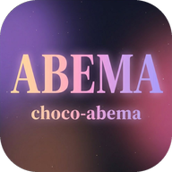 |

---
## スクリーンショット
| ⓵ | ⓶ |
|---------|-------|
| 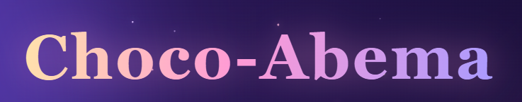 | 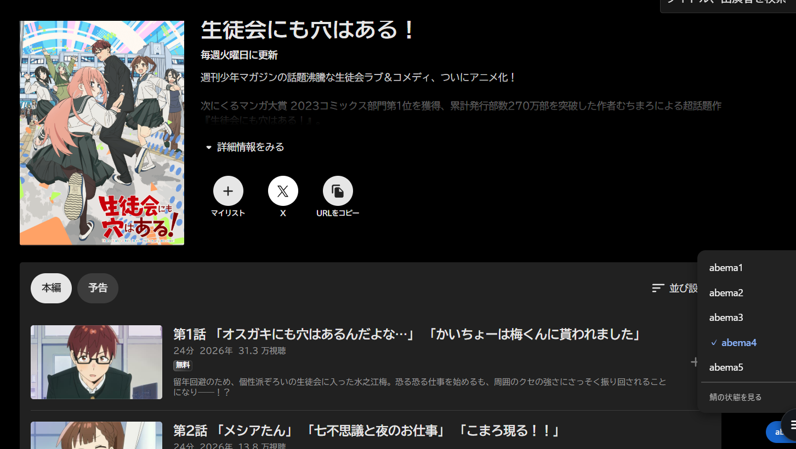 |

| ⓷ | ⓸ |
|---------|-------|
| 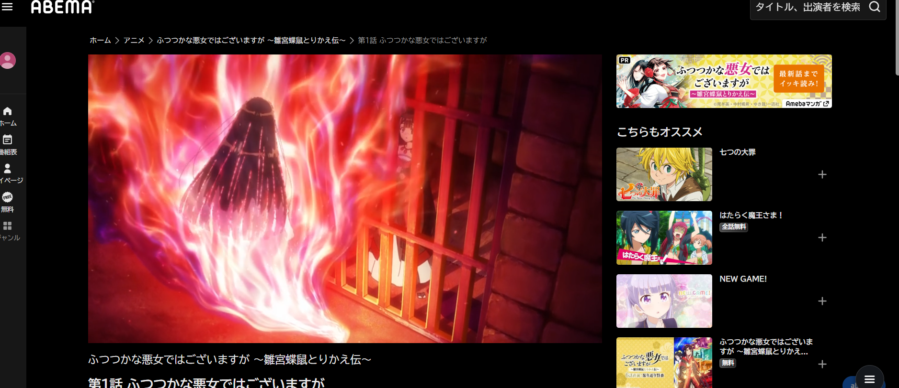 | 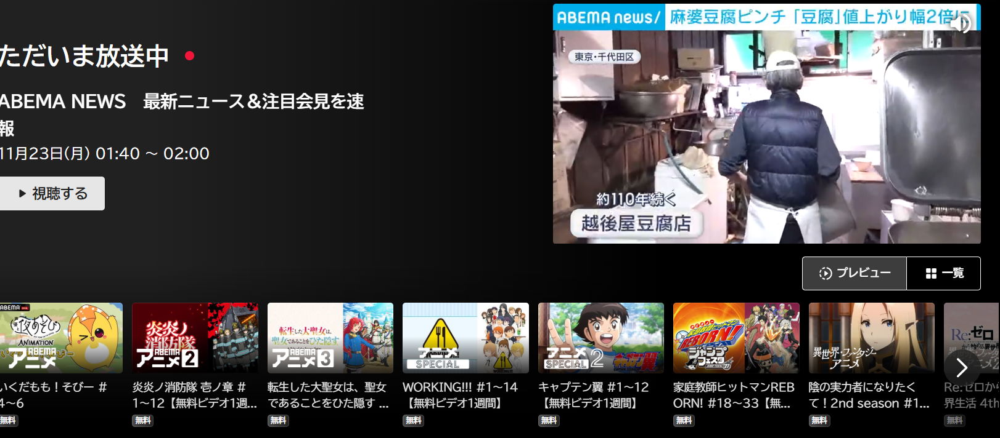 |

---
## Q&A
[サイトの挙動](#サイトの不具合、機能について)
[サイト内容への疑問](#当サイトに内容について)

---
### サイトの不具合、機能について
**パターン⓵Error1027が起きて使えません➡翌日9:00 A.M.には回復するのでお待ちください** <br>
| パターン⓵ | 
|---------|
| 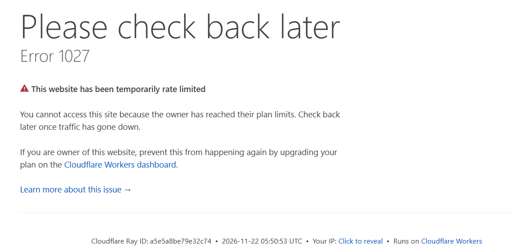 |

--- 
**パターン⓶画面が動かなかったり、Sorryとなります <br>➡一時的にそのサーバーに制限がかかっているので、むやみに再読み込みしないでください** <br>
| パターン2⃣-1 | パターン2⃣-2 |
|---------|---------|
| 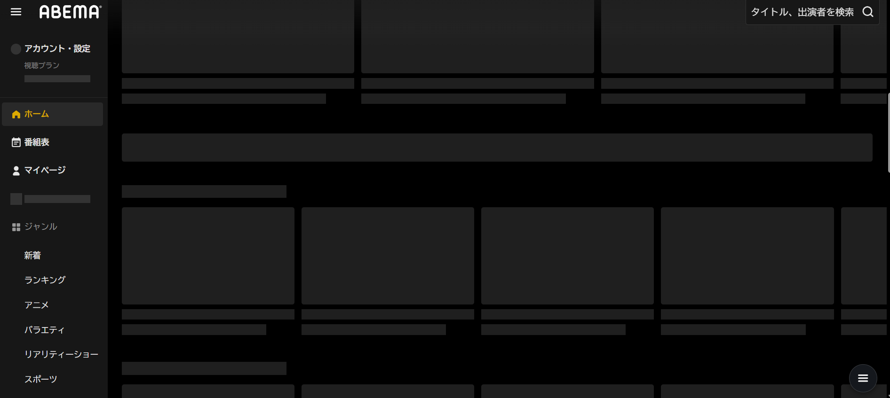 | 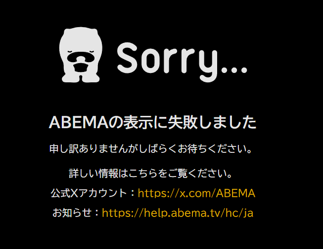 |

---
**パターン⓷お住まいの地域ではご視聴できません➡どのサーバーか言ってもらえれば対処します**
| パターン⓷ | 
|---------|
| 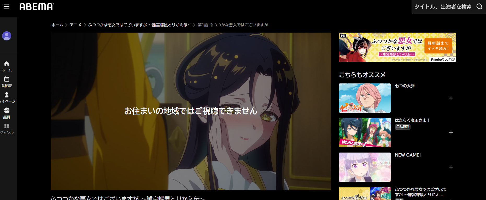 |

---
**パターン⓸すべてサーバーが429制限中となります➡サーバーの制限が切れるまでお待ちください**
| パターン⓸ | 
|---------|
| 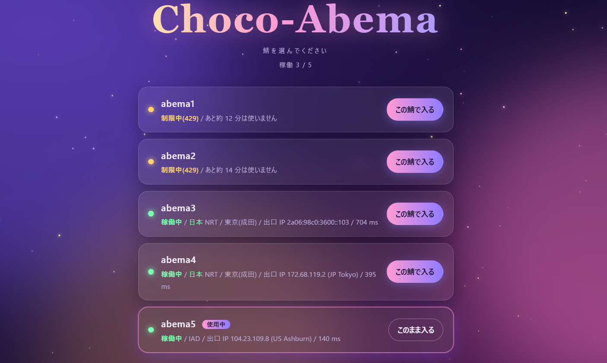 |

---
**パターン⓹About:Blankを選んだ際にパターン⓶と同じ症状になります➡現在原因を確認中です。確認次第対処します。**

---
### 当サイトに内容について
**Q1.これは法律、著作権的にOUTでは？** <br>
**A.OUTとは断定できません。** <br>
法律上： Renderなど他環境を経由してABEMAを見ること自体は、原則として違法ではありません。 <br>
著作権法上： 通常の視聴であれば、Proxyを使ったという理由だけで著作権侵害になるわけではありません。<br>

**Q2.でも視聴してるってことはデータを保存しているのでは?** <br>
**A.再生に伴う一時的な処理のため「直ちに」著作権侵害になるものではありません** <br>
ストリーミング方式で視聴しているため、動画データは再生や通信処理に必要な範囲で一時的にメモリやキャッシュなどに保持されることがあります。<br>
ただし、これは通常の再生に伴う一時的な処理であり、動画を恒久的に保存・ダウンロードすることとは異なります。<br>
また、一時的なデータ保持が直ちに著作権侵害になるわけではありません。 <br>

**Q3. ABEMAの動画を無断で取得しているのでは？** <br>
**A. 通常のストリーミング視聴ですので、動画を無断でダウンロードして配布する行為とは異なります。** <br>
また、動画をサーバーに保存しているわけではないため、ご理解ください。

**Q4. ABEMAの配信権を侵害していない？** <br>
**A. 日本国内向けの配信を日本国内から通常視聴する場合、他環境を経由したという理由だけで配信権侵害になるわけではありません。** <br>
日本国内であっても、住まいの地域によってみることのできない動画の視聴ができた場合は、確認が必要です。 <br>
ただし、そのようなことはあまりなく、気にする必要はほとんどありません。視聴前、確認程度にお調べ下さい。 <br>

**Q5. 他環境を経由しているだけで、ABEMAの動画を再配信していることにならない？** <br>
**A. 自分の視聴のために通信を中継しているため、不特定多数に動画を提供する再配信とは異なります。** <br>

**Q6.他環境の経由(proxyやvpn)はABEMA個別の規約違反なのでは?** <br>
**A.規約違反とは断定できません** <br>
このChoco-Abemaは、日本からで、abemaへアクセスし、それをrenderなどの環境で表示しているため、この問題とは関係性が薄いです。 <br>
「プロキシ（Proxy）やVPN経由でのアクセス、または海外IPアドレスからのアクセスが行われている場合,ABEMAを視聴することはできません。」<br>
とABEMA規約にありますが、「視聴することはできない」と、「視聴してはならない」とでは別物であり絶対的に禁止されているわけではないと解釈をとれます。 <br>
しかし、直ちに禁止ではないだけであり確認は必要です。

| ABEMA関連資料1 | ABEMA関連資料2 |
|---------|---------|
| 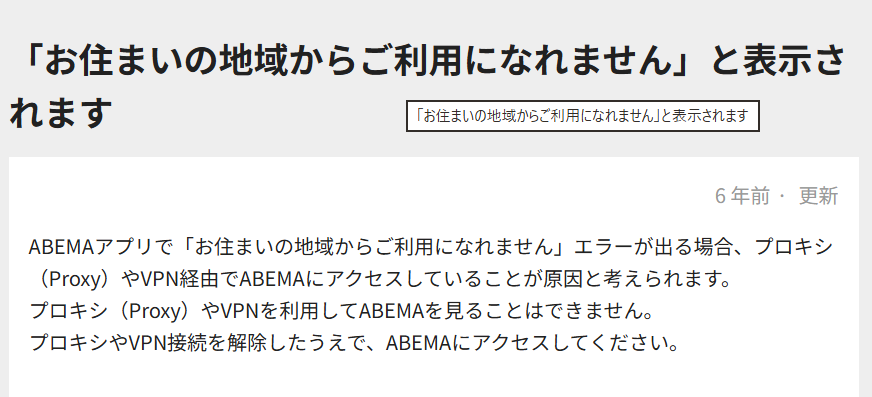 | 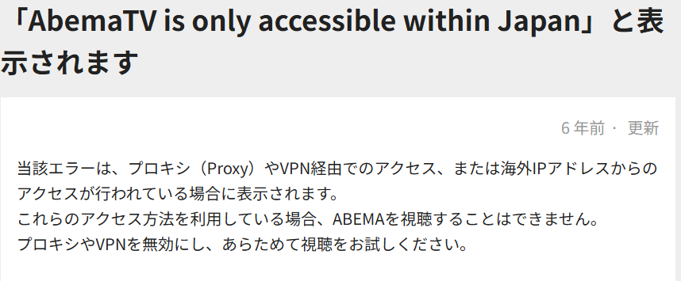 |

---
## デプロイ

### RENDER
1. このリポジトリをforkする
2. [Render](https://dashboard.render.com/)アカウントを作成し、ログイン後、「New」 → 「Web Service」
3. Githubアカウントと連携し、forkしたリポジトリを選択
4. 以下の枠に次のものを打ち込む <br>

**Name** <br>
.onrender.comの前の自分が作りたい文字列を入力<br>

**Build Command**
```
npm install
```
**Start Command**
```
node server.js
```
**Selected:** <br>
Freeを選択

5. Deploy web service をタップ
6. リンク完成

### Railway
1. [Railway](https://railway.com/dashboard) アカウント作成&ログイン
2. Githubリポジトリから選択で、自分のforkしたものをする
3. portは3000(多分)
4. URL生成完了

### Vercel

### Netlify

---
## その他
動画ストリーミングを行っており、Renderなどでは、容量がすぐ切れてしまうこともありえます <br>
他の人に共有するときは十分お気を付けください <br>
また、このserver.jsは技術悪用を防ぐため、難読化を施しています。ご承知ください。<br>
本サイトは、利用者自身の責任においてご利用ください。<br>
本サイトの利用にあたっては、ABEMAの利用規約および各種配信条件を遵守してください。<br>
また、本サイトはABEMAの公式サービスではなく、ABEMAとは無関係の第三者サービスです。視聴の可否や接続状況については保証できません。<br>
